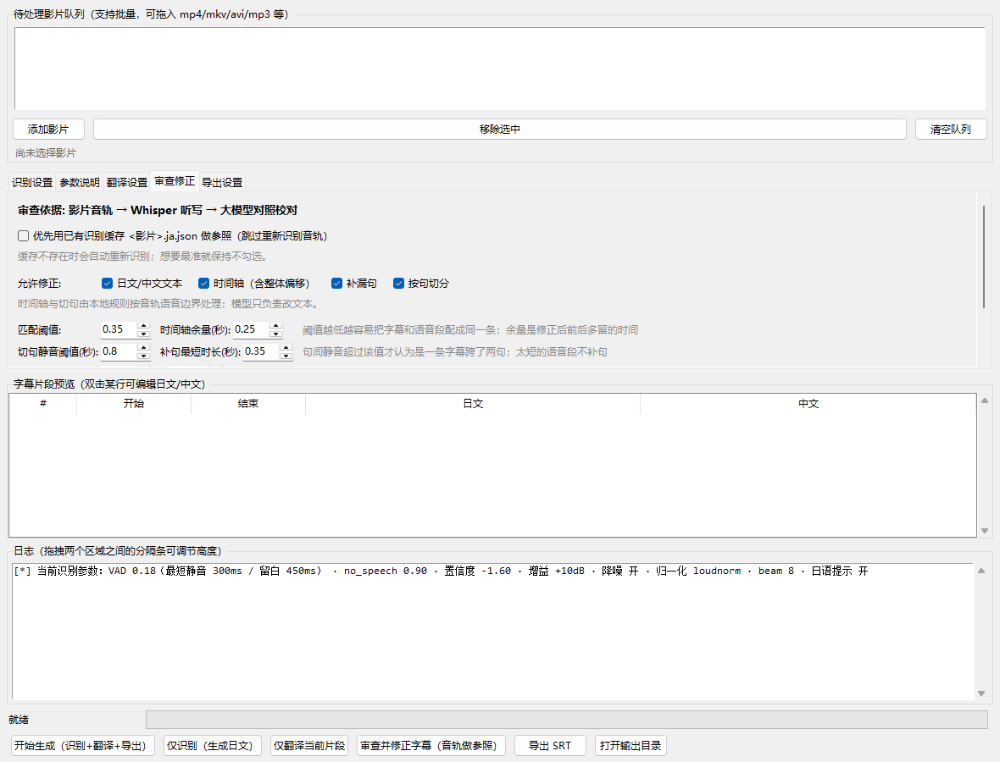

# 日语字幕生成器（SRT）

一个带图形界面的日语影片字幕工具：**本地 Whisper 大模型识别日语语音 → 大模型翻译成简体中文 → 导出 SRT 字幕**（支持中日双语，中文在上、日文在下）。

本工具是在你提供的 `生成日语字幕.bat` 基础上的 GUI 升级版：批量加载影片、可视化进度与日志、字幕片段预览与逐条编辑、多格式导出。



上图是「审查修正」页；识别、参数说明、翻译、导出都是同一窗口里的分页（[识别设置页截图](docs/gui-recognize.png)）。

## 获取代码

```bash
git clone https://gitee.com/ecslffl/dr-lin-fu.git     # Gitee（国内推荐）
git clone https://github.com/Ecslffl/dr-lin-fu.git    # GitHub 镜像，同一份代码
```

clone 后先跑一次 `安装依赖.bat`（或 `pip install -r requirements.txt`），再双击 `启动字幕生成器.bat`。仓库不含内置 Python 目录，需要本机有 Python 3.10+（含 tkinter）。发行版 `v1.0.0` 附带 zip 包。

## 功能

- **影片加载**：批量添加 mp4 / mkv / avi / mov / wmv / flv / webm 及常见音频格式，多文件队列依次处理
- **日语识别（ASR）**：faster-whisper 本地大模型（tiny→large-v3 可选，自动 CUDA/CPU），可选 VAD 静音过滤、音频归一化；也支持 OpenAI 兼容的云端转写 API
- **智能翻译**：调用大模型逐批翻译（LM Studio / Ollama / DeepSeek / 通义 等任意 OpenAI 兼容服务），自动检测在线模型，翻译失败自动重试
- **字幕导出**：SRT 格式，支持 中日双语（中文上/日文下，与视频同名可被 PotPlayer 自动加载）、仅中文、仅日文、日文+中文双文件
- **片段编辑**：识别/翻译结果表格预览，双击任意行可修改日文与中文后重新导出
- **字幕审查修正（v1.1 新增）**：提取影片音轨重新听写做参照，让大模型对照已有字幕逐条校对 —— 改日文错字、重写中文译文、按音轨语音边界收紧/纠正时间轴（含整体偏移）、补齐音轨说了但字幕漏掉的句子；结果写入新文件，原字幕不动
- **断点续做**：识别结果自动缓存为 `<影片>.ja.json`，再次处理时跳过识别直接翻译

## 目录结构

```
D:\AI_Work\SRT\
├── 启动字幕生成器.bat     ← 双击运行 APP（自动选择 Python 环境）
├── 安装依赖.bat           ← 首次使用先运行：安装/修复依赖
├── requirements.txt
├── README.md
├── 生成日语字幕.bat        ← 你原有的拖拽批处理脚本（未改动）
├── python\               ← 项目内置完整 Python 3.13.16（python.org 官方版，
│                           自带 tkinter/Tcl 8.6.15；本机原先缺少可用的 GUI Python，
│                           故随项目内置一份，可整体删除不影响系统）
│                           ※ 该目录约 2.4 GB，已写入 .gitignore，不在公开仓库里；
│                             clone 后需本机有 Python 3.10+（勾选 tcl/tk 与 pip），
│                             「安装依赖.bat」会自动探测 python\、.venv 或 PATH 中的 Python
└── jp_subtitle_app\       ← 应用源码
    ├── main.py           入口
    ├── gui.py            tkinter 界面
    ├── config.py         设置读写（settings.json）
    ├── audio.py          ffmpeg 音频解码/时长探测
    ├── asr.py            本地 Whisper / 云端 API 转写
    ├── translator.py     OpenAI 兼容大模型翻译
    ├── review.py         字幕审查与修正（音轨听写做参照）
    └── srt_builder.py    SRT 生成与导出
```

## 快速开始

1. **安装依赖**（一次性，约几分钟）：双击 `安装依赖.bat`
   - 自动检测 `python\` 内置 Python（或本机其他带 tkinter 的 Python）并安装 faster-whisper、numpy、requests、imageio-ffmpeg
   - GPU 识别还会装 CUDA 12 运行时 dll（`nvidia-cublas-cu12` / `nvidia-cuda-runtime-cu12` / `nvidia-cudnn-cu12` / `nvidia-cuda-nvrtc-cu12`，约 1.3 GB，见 requirements.txt）；`main.py` 会把它们加到 PATH，所以系统只装了 CUDA 13 也能用 GPU
   - 首次识别时会自动下载 Whisper 模型（large-v3 约 3GB，走 hf-mirror 国内镜像），之后走本地缓存
2. **启动**：双击 `启动字幕生成器.bat`
3. **准备翻译服务**（二选一）：
   - **LM Studio（推荐，本地免费）**：启动 LM Studio → 加载一个中文翻译模型（如 Qwen2.5-7B-Instruct）→ 打开 Developer 页签 → Start Server（默认 `http://127.0.0.1:1234/v1`）
   - **云端 OpenAI 兼容服务**：在「翻译设置」页填 API 地址、API Key、模型名（如 DeepSeek: `https://api.deepseek.com/v1` + `deepseek-chat`）
4. **操作**：添加影片 → （可选）点「检测在线模型」自动识别翻译模型 → 点「开始生成」→ 完成后在影片同目录生成 `.srt`
5. **（可选）审查已有字幕**：队列里放影片 → 点底部「审查并修正字幕（音轨做参照）」→ 程序自动找同目录同名 `.srt`（找不到会弹窗让你选）→ 修正结果写入 `<原名>.fixed.srt`，原字幕不动

## 界面说明

| 页签 | 设置项 | 说明 |
|---|---|---|
| 识别设置 | 参数预设 | 「推荐（默认）」「轻声 / 含糊对话」「嘈杂 / 音乐音效多」「原音保真 / 追求速度」，一键套用一组相互配合的参数 |
| | 识别引擎 | `local` 本地 Whisper（默认）；`api` 云端转写接口 |
| | Whisper 模型 | tiny/base/small/medium/large-v3；API 模式填 API 模型名（如 whisper-1） |
| | 计算设备 | auto / cuda / cpu，自动识别 N 卡 |
| | VAD 阈值 | 判“是人声”的门槛，默认 **0.25**（旧版 0.35）。调低到 0.18–0.22 可抓到轻声/呢喃对话 |
| | VAD 最短静音 / 语音留白 | 默认 **400ms / 300ms**。留白加大可防止轻声字头被切掉 |
| | 音频增益 / 降噪 | 默认 **+6dB / 开**。解码时先抬音量、再归一化、最后降噪，把轻声送进模型舒适区间 |
| | 音频归一化 | 默认 dynaudnorm（逐窗拉平）；整片偏小声用 loudnorm；none 会削弱轻声增强 |
| | no_speech / 置信度阈值 | 默认 **0.75 / -1.2**。调高前者、调低后者可减少“被当成静音而丢弃”的台词 |
| | 日语提示词偏置 | 默认开，让模型按日语习惯输出，改善含糊发音 |
| | 静音断句 / 阈值 | 停顿超过阈值就断开字幕，静音期留白，默认 0.6 秒 |
| 参数说明 | — | 每个参数“作用 / 调大调小的后果 / 推荐值”的完整说明，2630 字 |
| 翻译设置 | API 地址 | LM Studio/Ollama/云端 /v1 地址 |
| | 翻译模型 | 留空点「检测在线模型」自动填充 |
| | 批量翻译 | 更快，默认开启；每批最大字符/行数可调 |
| 审查修正 | 优先用识别缓存 | 勾选=拿已有 `<影片>.ja.json` 当参照（秒级开始）；不勾=重新听写音轨（最准） |
| | 允许修正 | 文本（日文+中文）/ 时间轴（含整体偏移）/ 补漏句 / 按句切分，可多选 |
| | 匹配阈值 / 时间轴余量 | 默认 **0.35 / 0.25s**。阈值低=更容易把字幕和语音段配成同一条 |
| | 切句静音阈值 / 补句最短时长 | 默认 **0.8s / 0.35s** |
| | 每批条数 / 字符 | 默认 **20 条 / 1600 字符**；本地小模型别开太大 |
| | 输出文件名后缀 | 默认 `.fixed`，原字幕不动 |
| 导出设置 | 导出格式 | bilingual 双语（默认）/ zh 中文 / ja 日文 / separate 双文件 |
| | 输出目录 | 留空 = 与影片同目录 |
| | 文件名后缀 | 留空时双语字幕与影片同名 `.srt`，PotPlayer 自动加载 |

**窗口布局**：五个设置页都是**固定高度 + 垂直滚动条**（鼠标滚轮可直接滚动），设置区不再随内容长高；省出来的高度给到中部，**日志区与字幕片段预览初始等高**，两者之间的分隔条可拖拽调节，窗口拉大时两边等比例增长。

## 字幕审查修正（音轨做参照）

已经有一份 `.srt`（自己做的、别处下的、上一版程序生成的都行），想让它更准时用这个功能。

**为什么不能直接把音轨丢给大模型**：LM Studio / Ollama 这类 OpenAI 兼容服务只接受文本，不能“听”音频。所以流程固定为：

```
影片音轨 → ffmpeg 解码 → Whisper 重新听写（ref，语音事实来源）
                              ↓
现有 .srt → 解析日文/中文 → 按时间重叠与 ref 对齐 → 整体偏移估计
                              ↓
              大模型逐批复审：改日文错字 · 重写中文译文
                              ↓
        本地规则：纠正整体偏移 · 收紧时间轴 · 按句切分 · 补齐漏句
                              ↓
                   写入 <原名>.fixed.srt（原文件不动）
```

几个实现要点：

- **大模型只改文本**。时间戳交给本地规则算，因为小模型输出的时间码不可靠，容易把时间轴改乱。
- **整体偏移会先纠正**：字幕整体提前/滞后（换版本、裁片头、帧率差异很常见）时，程序用“语音段起点 − 最近字幕起点”的中位数估算偏移量，再用它对齐；不先纠正的话短句会完全对不上，补句还会把已有台词重复插入。实测 60 秒真实素材上偏移 1.5s 时，纠偏移前 9 条只对上 4 条，纠正后 9/9 对齐。
- **补漏句**只补“音轨确实有语音、但没有任何字幕命中”的段；与现有字幕重叠过半的段会被跳过，避免重复。
- **切句**只在“一条字幕跨多句、句间有静音、文本能按句对应”时才切，文本对不上就不切（日志里标「未切句」），宁可不切也不乱切。
- 审查过程会在日志里输出逐条报告：日文改动、中文改动、时间轴前后、补了哪句、哪句没切、哪句保留。

代价：勾「优先用识别缓存」是秒级开始；不勾就要重跑一次听写（RTX 2060 + `base` 实测 60 秒音频约 5 秒，large-v3 全片 133 分钟约 20~40 分钟）。

## 轻声 / 含糊对话漏识别怎么调

按“先送进去、再敢留下、最后求准确”三步走：

1. **先确保声被送进模型**：VAD 阈值 0.18–0.22、语音留白 400–450ms、音频增益 +8~+12dB、降噪开。
2. **再别让模型把台词丢掉**：no_speech 阈值 0.85–0.90、置信度阈值 -1.5~-1.6。
3. **最后求准确**：Beam Size 8、日语提示词开、模型用 large-v3。

以上组合已打包为「轻声 / 含糊对话」预设，在「识别设置」页选中后点「套用预设」即可。

参数原理与实测依据：
- `dynaudnorm` 用默认 `f=500:g=31` 时对轻声几乎不动（实测 0dB 增益），必须 `f=200:g=15` 才生效，且 `m`（最大放大倍数）默认 10 只够 +20dB，轻声档已放宽到 30；
- `afftdn` 降噪若放在归一化之前，会把低于噪声门限的轻声整体当噪声压掉（实测 -52dBFS → -64dBFS），因此链路顺序固定为 **增益 → 归一化 → 降噪**；
- 实测校准：-52dBFS 轻声素材经默认链提升 **+37dB**；数字静音仍为 0；-70dBFS 微弱底噪仅到约 -41dBFS，不会凭空造出大电平噪声。

## 常见问题

- **识别出 0 段 / 大量漏识别**：先点「轻声 / 含糊对话」预设；仍不行再单独压低 VAD 阈值（最低 0.15）、加大语音留白到 500ms
- **漏句但不想引入伪字幕**：只调 no_speech 阈值（0.75→0.85）与置信度阈值（-1.2→-1.5），VAD 保持 0.25
- **Whisper 反复输出同一句（幻觉循环）**：勾掉「使用上文提示识别」（默认已关闭），并留意启动日志里的参数体检提示
- **CUDA 报错 / 黑屏卡死**：设备选 `cpu` 跑（速度较慢但稳定）；N 卡驱动建议更新
- **`Library cublas64_12.dll is not found or cannot be loaded`**：缺 CUDA 12 运行时，重跑一次 `安装依赖.bat`（会装上面那几个 `nvidia-*-cu12` 包）；实在装不上就把设备改成 `cpu`
- **提示无法连接翻译服务**：确认 LM Studio 已启动 Server；或改用云端服务并填 API Key
- **模型下载慢**：脚本默认走 `https://hf-mirror.com` 镜像；已设置 `HF_ENDPOINT` 则尊重你的配置
- **审查后漏句没补上 / 补重复了**：先看日志里的「整体偏移」和「未补句」提示；重复补句一般是匹配阈值太低，把它调到 0.45~0.55；漏句没补一般是阈值太高，降到 0.25
- **审查后字幕变短、中间空一截**：说明按音轨收紧生效了（原字幕挂在无语音区间）。想保留原时间轴就取消勾「时间轴」
- **审查不动任何文本**：本地模型没返回合规格式时日志会打「一批审查失败」；换大一点的模型或把每批条数降到 10~15

## 说明与限制

- 音频解码走 ffmpeg（imageio-ffmpeg 内置），无需单独安装 ffmpeg
- 字幕时间轴来自 Whisper 识别结果，编辑片段只改文本不影响时间轴
- 首次使用本地大模型需联网下载模型；识别与翻译都在本机/你配置的服务完成

## 许可证

MIT，见 [LICENSE](LICENSE)。第三方依赖各自的许可证不变：faster-whisper（MIT）、ctranslate2（MIT）、imageio-ffmpeg（Apache-2.0）、numpy（BSD-3）、requests（Apache-2.0）。下载的 Whisper 模型权重由 Hugging Face 上的各自许可证约束（`tiny/base/small/medium/large-v3` 均为 MIT），与本项目许可证无关。
